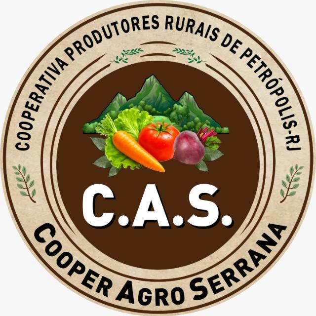

# App da Cooperativa

App da **Cooperativa dos Produtores Rurais de Petrópolis (C.A.S. – Cooper Agro Serrana)** para a merenda
escolar (PNAE). Faz no computador o que a planilha de controle faz, com as mesmas contas:

- previsão de produção e mensagens de WhatsApp para os produtores;
- pedido da Prefeitura com os cortes da nutricionista e divisão entre os produtores;
- galpão (o que cada produtor trouxe), mapa de montagem, excedente e romaneios para imprimir;
- retornos das escolas, reentregas, fechamento da semana, extratos e resumo de todas as semanas.

## Começar

**Leia o [COMO-USAR.md](COMO-USAR.md)**: instalar, abrir, atualizar e usar, passo a passo.

Resumo: instale o Node.js (LTS), baixe esta pasta, coloque `dados-cooperativa` dentro e dê dois cliques em
**`abrir-app.bat`**. O app abre em http://localhost:3000/coop e cria um atalho na Área de Trabalho.

## Pastas

| Pasta / arquivo | O que é |
| --- | --- |
| `abrir-app.bat` | abre o app (instala e prepara na primeira vez) |
| `atualizar-app.bat` | pega a versão nova (para quem não usa o GitHub Desktop) |
| `liberar-celular.bat` | libera o app no Firewall do Windows para o celular abrir (uma vez só) |
| `COMO-USAR.md` | tutorial |
| `docs/como-funciona.md` | regras das contas e onde ficam os dados |
| `src/app/coop` | as telas |
| `src/lib/coop` | as contas (igual à planilha MODELO) e a leitura das planilhas |
| `scripts/coop` | abrir o app e conferir as contas com uma planilha |
| `dados-cooperativa/` | **seus dados** (não vai para o GitHub; faça backup pelo app) |
